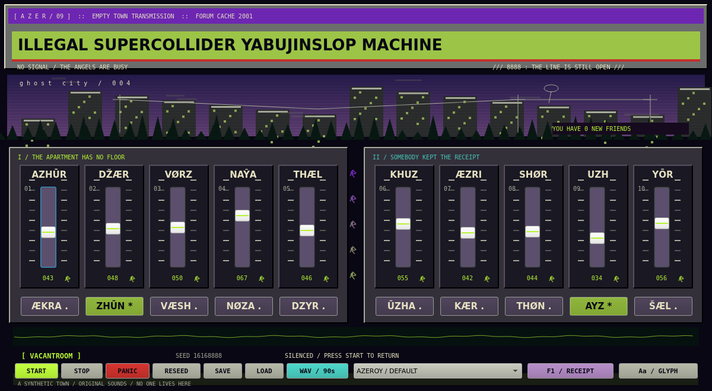

# ILLEGAL SUPERCOLLIDER YABUJINSLOP MACHINE

A haunted generative beat instrument for SuperCollider. Ten mysterious sliders and ten switches jointly bend drums, original melodies, ghost voices, musical memory, crushing, tape damage, and echo. Scenes recur and mutate instead of following a fixed song-section ladder.



## Run it

1. Install **[SuperCollider](https://supercollider.github.io/downloads.html)**, including its language, audio server and IDE. Tested with **3.13.0**. No Quarks, SC3plugins, paid plugins or API keys are needed.
2. Clone/download this repository. Keep its folders together.
3. Open **`Main.scd`** in the SuperCollider IDE, select the whole file, and press **Ctrl+Enter** on Windows/Linux or **Cmd+Enter** on macOS.
4. Wait for **READY / PRESS START**, then click **START**. Move the sliders, enable switches, and try the four presets. **F1 / RECEIPT** explains the inscriptions. **PANIC** silences playback; START brings it back.

Start at a comfortable output volume. The default patch is balanced; `PHONE RAVE` is faster and telephone-colored, `VACANT ANGEL` is spacious, and `1616 FRACTURE` enables every intervention family. A switch permits a behavior; the scene engine decides when it occurs.

**SAVE / LOAD** choose a patch file and preserve all twenty controls and the seed. Four factory patch files are also included in `presets/`. **RESEED** makes another composition with the current controls. **WAV / 90s** chooses an output path and generates a new deterministic 90-second arrangement with a short tail, independently of the realtime audio device. Export is an arrangement from the patch/seed, not a capture of the performance you just played. For live recording use SuperCollider's server recording controls.

The visible words are original Azeroy-inspired invented labels, not authenticated Azeroyska translations. The project creates original music inspired by the requested atmosphere; it includes no Yabujin song samples. The animated line is control-state artwork.

## Audio setup

macOS/Windows: select your working audio device in SuperCollider before evaluating Main. For example, evaluate `Server.default.options.device = "your device name";` before starting if you need a specific device. The machine uses stereo output and no audio inputs.

Linux: install SuperCollider through your distribution and use a working JACK/PipeWire-JACK audio setup. If boot fails, inspect SuperCollider's Post window, start/configure your audio backend, then re-evaluate Main. Offline WAV export remains available if realtime hardware is unavailable.

Closing the window frees the instrument's own nodes, buffers, buses and schedulers. It leaves the shared SuperCollider server available to other projects. Re-evaluating Main replaces the prior instance. If you manually reboot the audio server, re-evaluate Main afterward.

## Sounds

The synthetic foundation includes kick, snare/clap, metallic hats, bass, breathy bell/flute, pads, formants and noise. **28 downloaded Kenney CC0 sounds** add metal/glass/concrete impacts, phone-like tones, glitches, scratches and sweeps. The complete bank is bundled: first launch needs no downloads.

[Asset provenance and checksums](assets/LICENSES.json) and original notices document each source. To verify the bank, run `python3 tools/fetch_assets.py --verify-only`; `python3 tools/fetch_assets.py` restores missing assets from the pinned official packs. FFmpeg is needed only for restoration, not playback. Removing the optional WAV bank leaves the synth engine operational.

## Offline command line

With `sclang` and `scsynth` on PATH, from the repository root:

```bash
QT_QPA_PLATFORM=offscreen ISM_PRESET=2 ISM_SECONDS=90 \
  ISM_OUTPUT="$PWD/renders/phone-rave.wav" sclang -D "$PWD/tools/render.scd"
```

On macOS/Windows use the equivalent environment setup for your shell or export through the GUI. The command prints render completion and exits; WAVs include 3.25 seconds of tail/fade. Preset indices are 0–3. Optional `ISM_SEED` changes the seed. `ISM_NO_SAMPLES=1` validates the fully synthesized fallback. Development control overrides `ISM_SLIDERS` and `ISM_SWITCHES` take exactly ten comma-separated numeric values each.

For **Debian 13 cloud validation without root**, run:

```bash
bash tools/bootstrap-cloud.sh
QT_QPA_PLATFORM=offscreen ISM_PRESET=2 ISM_SECONDS=90 \
  ISM_OUTPUT="$PWD/renders/phone-rave.wav" \
  /workspace/ism-toolchain/bin/sclang -D "$PWD/tools/render.scd"
```

The helper uses signed Debian packages and installs locally; it is not a desktop installer. Cloud tasks already have isolated checkouts: use the existing repository rather than creating a worktree. Live processes must be started again after an environment snapshot is restored.

## Development and checks

- [Control mappings](docs/CONTROL_MAP.md)
- [Architecture](docs/ARCHITECTURE.md)
- [Validation evidence and limits](docs/VALIDATION.md)
- [Reference research](docs/REFERENCE_NOTES.md)
- [Development and agent plan](docs/DEVELOPMENT_PLAN.md)

```bash
QT_QPA_PLATFORM=offscreen sclang -D "$PWD/tests/composer_tests.scd"
ISM_NO_BOOT=1 sclang -D "$PWD/tests/gui_tests.scd"   # requires desktop display/Xvfb
python3 -m unittest discover -s tests -p 'test_*.py'
python3 tools/analyze_audio.py renders/phone-rave.wav --expected-seconds 93.25
python3 tests/audio_controls.py --sclang /path/to/sclang
```

Realtime tests require a working backend; `tests/realtime_tests.scd` exercises actual playback, panic/restart, memory continuation and cleanup. The checked-in demo WAVs are short excerpts. Automated audio measurements establish finite output and behavior changes; they do not substitute for a listener's aesthetic judgment.

Code and original procedural artwork: MIT. Bundled Kenney sounds: CC0; see their included notices.
